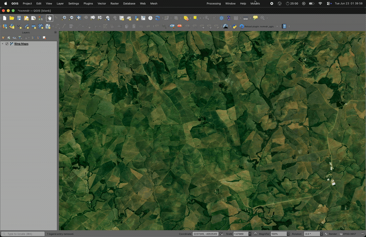

# Anaximander

A high-performance geospatial AI inference server supporting PyTorch, ONNX, and HuggingFace models via gRPC, Torch RPC, and an optional Azure OpenAI proxy.



## Features

- **Multi-format model support**: PyTorch, ONNX, HuggingFace, TorchHub
- **gRPC inference API**: Stream or batch predictions with configurable chunking
- **Torch RPC**: Distributed inference across multiple workers
- **Azure OpenAI proxy**: Forward vision requests to Azure-hosted models
- **Session management**: Stateful inference sessions with tile-level tracking
- **Model caching**: LRU cache with pinning for frequently used models

## Quick Start

```bash
# Create environment
conda create -n nxmndr python=3.11 -y
conda activate nxmndr

# Install with all dependencies
cd nxmndr/
pip install -e .[server,dev]

# Start the gRPC inference server (default: 127.0.0.1:50051, this machine only)
nxmndr-server

# Or specify a custom gRPC port and enable the Azure OpenAI proxy (also on 127.0.0.1)
nxmndr-server --grpc-port 50051 --azure-proxy --http-port 8080
```

To accept connections from other machines add `--host 0.0.0.0`; read [Security](nxmndr/README.md#security) first.

## Usage

### Python Client

```python
from nxmndr.client import InferenceGrpcClient
import numpy as np

client = InferenceGrpcClient("localhost:50051")

# Load a model
client.load_model(model_path="/path/to/model.onnx", model_type="onnx")

# Run inference
input_tensor = np.random.rand(1, 3, 256, 256).astype(np.float32)
result = client.predict(model_id="<model_id>", tensor=input_tensor)
```

See [`examples/`](nxmndr/examples/) for more usage patterns including ChatGPT Vision integration.

## Development

### Running Tests

```bash
cd nxmndr/

# Unit tests (no external services or GPU required)
pytest -m unit -q

# Integration tests (spins up ephemeral gRPC servers)
pytest -m integration -q

# All tests
pytest -q
```

### Code Quality

```bash
cd nxmndr/
ruff check src/
mypy src/
```

## Documentation

- [Server README](nxmndr/README.md) - Installation, API documentation, gRPC/Torch RPC details
- [Changelog](nxmndr/CHANGELOG.md) - Breaking changes for clients and operators
- [Azure OpenAI Setup](nxmndr/docs/azure_setup.md) - Azure proxy configuration
- [ChatGPT Vision Guide](nxmndr/docs/chatgpt_vision.md) - Vision model integration

## Test Fixtures

Test model weights (.pth, .onnx, .bin) are **not checked into git**. They are auto-generated by `modeling_exampleconv.py` when you first run `pytest`. The test GeoTIFF (`nxmndr/tst/integration/image.tif`) is a small synthetically generated raster (EPSG:3857).

## License

MIT License - see [LICENSE](LICENSE) for details.
